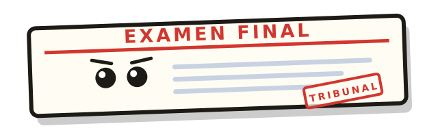

# 🎮 <NOMBRE DEL PROYECTO>

> <Una frase que resuma el proyecto: «Una colección de minijuegos sobre la vida en la USC».>

<!-- Banner: sube una captura o GIF a docs/ y enlázalo aquí -->


---

## 📑 Índice

- [Concepto](#-concepto)
- [Minijuegos](#-minijuegos)
- [Cómo jugar](#-cómo-jugar)
- [Controles](#-controles)
- [Stack y arquitectura](#-stack-y-arquitectura)
- [Estructura del proyecto](#-estructura-del-proyecto)
- [Equipo](#-equipo)
- [Hoja de ruta](#-hoja-de-ruta)
- [Convenciones de trabajo](#-convenciones-de-trabajo)
- [Licencia y créditos](#-licencia-y-créditos)

---

## 💡 Concepto

**<NOMBRE DEL PROYECTO>** es una colección de minijuegos cortos ambientados en la
**Universidade de Santiago de Compostela**: sus campus, sus facultades, sus
tradiciones y sus pequeños dramas cotidianos.

- **Formato:** minijuegos independientes de 1-3 minutos, unidos por un menú común.
- **Público:** estudiantes, personal y cualquier persona que haya pasado por la USC.
- **Objetivo:** que en menos de un minuto alguien entienda el chiste, juegue y quiera probar otro.
- **Tono:** humor universitario, cariñoso y reconocible. Nada de parodias que señalen a personas reales.

<!-- TODO: 2-4 líneas explicando por qué este proyecto y no otro. ¿Qué lo hace gracioso o especial? -->

**Referencias:** *WarioWare*, *Paper Mario*, *Los Simpson: el videojuego*, <otras>.

---

## 🕹️ Minijuegos

| # | Minijuego | Idea en una línea | Mecánica | Estado | Autor/a | Fichero |
|---|-----------|-------------------|----------|--------|---------|---------|
| 1 | **Examen Final** | Enfrentate al examen final convertido en jefe de RPG | Turnos + *timing* (Paper Mario) | Incompleto | Manuel | `ExamenFinal/examen-final.html` |
| 2 | <Nombre> | <Una línea> | <Mecánica> | 🚧 En progreso | <Nombre> | `<fichero>` |
| 3 | <Nombre> | <Una línea> | <Mecánica> | 💡 Idea | <Nombre> | `<fichero>` |

**Leyenda:** ✅ jugable · 🚧 en progreso · 💡 idea · ❌ descartado

<p align="center">
  
</p>

### Ficha de minijuego (plantilla)

> Copia este bloque por cada minijuego nuevo.

#### <Nombre del minijuego>

- **Pitch:** <una frase>
- **Ambientación USC:** <campus, facultad, tradición o situación>
- **Mecánica principal:** <el único verbo que define el juego>
- **Duración:** <30 s / 1 min / 3 min>
- **Victoria:** <qué tiene que conseguir el jugador>
- **Derrota:** <cómo se pierde>
- **Controles:** <teclado / ratón / ambos>
- **Estado:** <idea / prototipo / jugable / pulido>
- **Autor/a:** <nombre>
- **Fichero:** `<ruta>`

---

## ▶️ Cómo jugar

### Opción rápida

Abre **`index.html`** en el navegador (doble clic) y elige un minijuego desde la
pantalla de inicio. No requiere instalación ni conexión a internet.

### Servidor local (recomendado)

```bash
# con Python, ya instalado en la mayoría de sistemas
python -m http.server 8000

# o con Node
npx serve .
```

Después abre <http://localhost:8000>.

### Requisitos

- Navegador moderno (Chrome, Edge, Firefox o Safari).
- Teclado y ratón. <TODO: indicar si hay soporte táctil>

---

## ⌨️ Controles

| Acción | Tecla |
|--------|-------|
| Confirmar / atacar | `Espacio` |
| Elegir opción | `1`-`6` o clic |
| Pausa | `Esc` |
| Silenciar | botón 🔊 |

<!-- TODO: ajustar a los controles reales del conjunto de minijuegos -->

---

## 🛠️ Stack y arquitectura

- **Motor:** HTML5 + CSS3 + JavaScript vanilla (sin dependencias ni build).
- **Render:** DOM y CSS para la interfaz; `<canvas>` cuando haga falta.
- **Audio:** WebAudio API (efectos sintetizados, sin ficheros externos).
- **Datos:** sin backend. Todo ocurre en el navegador.
- **Persistencia:** `localStorage` para récords y progreso. <TODO: confirmar>

**Decisiones de diseño**

- Cada minijuego es un fichero **autocontenido**: se puede abrir y jugar solo.
- Nada de *frameworks*: menos configuración, más tiempo para el contenido.
- Estética de papel/cartón y tipografía manuscrita para dar unidad visual.

<!-- TODO: si añadís canvas, Phaser o un menú hub, documentarlo aquí -->

---

## 📂 Estructura del proyecto

```text
.
├─ index.html               # pantalla de inicio (hub de minijuegos)
├─ README.md
├─ Ideas_Juego              # lluvia de ideas del equipo
├─ assets/
│  └─ favicon.svg           # icono del hub
├─ ExamenFinal/
│  ├─ examen-final.html     # minijuego 1
│  ├─ styles.css
│  ├─ game.js
│  └─ assets/
│     ├─ favicon.svg
│     └─ logo.svg
├─ flappy-bird.html         # prototipo de referencia
└─ <Minijuego>/
   └─ <fichero>.html        # minijuegos siguientes
```

### Añadir un minijuego al hub

En `index.html` hay una lista `JUEGOS` con una plantilla comentada. Para añadir uno:

1. Crea la carpeta del minijuego (por ejemplo `MiJuego/`) con su HTML.
2. Copia el bloque de plantilla de `JUEGOS` y rellena título, descripción, género y autor.
3. Pon `estado: 'jugable'` y la ruta en `ruta: 'MiJuego/index.html'`.

Los minijuegos que aún no existen se muestran como tarjetas «En construcción»
(`estado: 'construccion'`), sin enlace.

---

## 👥 Equipo

| Nombre | Rol | Minijuego | GitHub |
|--------|-----|-----------|--------|
| Manuel | <Rol> | Examen Final | [@USC-ManuAzza](https://github.com/USC-ManuAzza) |
| Laura | <Rol> | <Minijuego> | <@usuario> |
| Pablo | <Rol> | <Minijuego> | <@usuario> |
| Carmen | <Rol> | <Minijuego> | <@usuario> |

<!-- TODO: repartir roles: programación, arte, sonido, guion, QA, presentación -->

---

## 🗺️ Hoja de ruta

- [x] Elegir concepto: colección de minijuegos sobre la USC
- [x] Prototipo jugable del minijuego 1 (Examen Final)
- [x] Menú común que enlace todos los minijuegos (`index.html`)
- [ ] Minijuego 2: <nombre>
- [ ] Minijuego 3: <nombre>
- [ ] Minijuego 4: <nombre>
- [ ] Unificar estilos, controles y sonido
- [ ] Récords en `localStorage`
- [ ] Versión móvil
- [ ] Vídeo de demo (60-90 s)
- [ ] README definitivo con capturas

### Checklist de entrega

- [ ] Todos los minijuegos se abren sin errores
- [ ] Controles explicados en pantalla
- [ ] Sin *assets* externos que fallen sin internet
- [ ] Créditos y licencia
- [ ] Demo ensayada (2 minutos)

---

## 🤝 Convenciones de trabajo

- **Ramas:** `main` siempre jugable. Trabajo en `feat/<minijuego>` o `fix/<tema>`.
- **Commits:** en imperativo y cortos — `Añade minijuego de la tuna`, `Corrige el timing del bloqueo`.
- **Un minijuego = un fichero.** Evitad tocar el fichero de otra persona sin avisar.
- **Antes de subir:** abrir el minijuego en el navegador y comprobar que no hay errores en consola.

---

## 📜 Licencia y créditos

- **Código:** MIT. <TODO: o la licencia que elijáis>
- **Arte y sonido:** <propio / generado / con licencia X>
- **Marcas:** proyecto no oficial, sin relación con la Universidade de Santiago de Compostela.
- **Agradecimientos:** <personas, tutoriales, assets>

<!-- TODO: si usáis fuentes, sprites o música de terceros, citad autor y licencia -->
